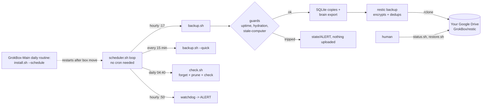
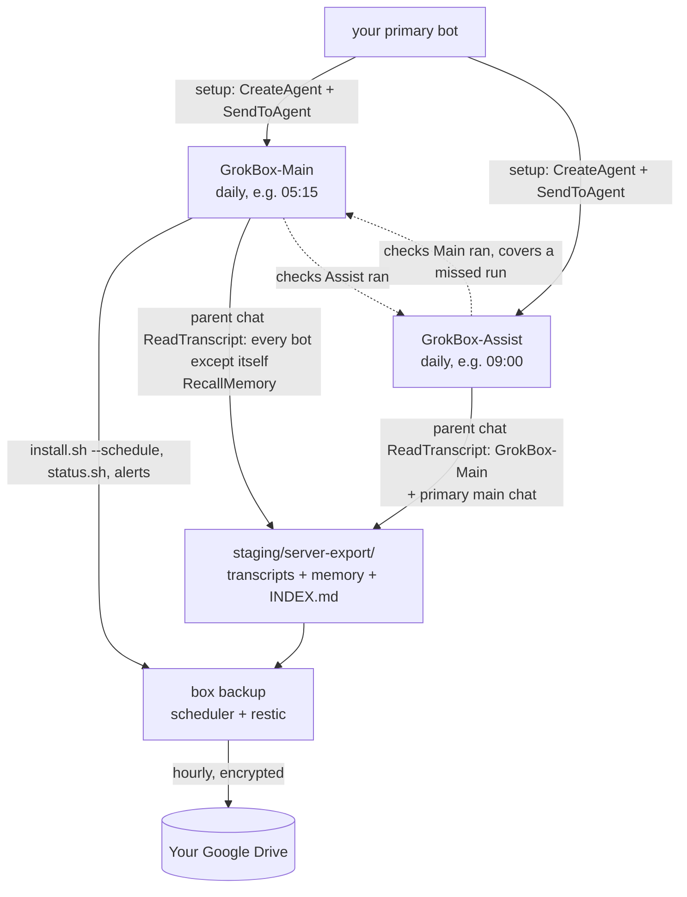

# Grok Box

[](LICENSE) [](https://github.com/dorukardahan/grokbox)

Time-Machine-style, **encrypted** backups of a Grok Bot's persistent Linux box (`/workspace`, `/home/box`) to
**your own Google Drive**, with [restic](https://restic.net) + [rclone](https://rclone.org). No root, no cron daemon,
no server run by anyone else.

```bash
git clone https://github.com/dorukardahan/grokbox /workspace/grokbox
```
**Using a Grok Bot?** Paste the repo link to it: [AGENTS.md](AGENTS.md) tells it exactly what to do and which three
steps need you (Google Cloud OAuth client, one consent click, saving the restic password), plus a few choices it asks
you about (time zone, whether credentials go into the backup, where alerts are sent).

Inspired by the community restic setup idea.

> **Status & disclaimer**
> - A community project, maintained best-effort. Provided **as is** under the MIT license, with no warranty.
> - Backups can fail. Test your restores (`./test-restore.sh`, `./doctor.sh`); you are responsible for your data.
> - **Credentials are backed up by default** (`BACKUP_SECRETS=1`): tokens and logins on the box end up inside the
>   encrypted repository. See [What is and is not backed up](#what-is-and-is-not-backed-up).
> - Not affiliated with Google, restic, rclone or the Grok Bot platform.
>
> Contributing: [CONTRIBUTING.md](CONTRIBUTING.md). Security reports: [SECURITY.md](SECURITY.md).

## Requirements & platform assumptions
- A Linux box (amd64 or arm64) with bash 4+, `python3` (standard library only; SQLite copies use its `sqlite3`
  module), `curl` (or `wget`) and coreutils/util-linux (`timeout`, `flock`, `sha256sum`). No root. The `sqlite3`
  command-line tool is optional (handy for the integrity check in [REBUILD.md](REBUILD.md)).
- `./install.sh` downloads two programs into `bin/`: [restic](https://restic.net) and [rclone](https://rclone.org), at the
  versions pinned in `config.env.example` (`PINNED_RESTIC`, `PINNED_RCLONE`), checked against [checksums.txt](checksums.txt)
  and the upstream `SHA256SUMS`.
- A Google account with Drive, and (recommended) your own Google OAuth client ([docs/google-cloud-setup.md](docs/google-cloud-setup.md)).

Grok Bot defaults, all changeable in `config.env`:

| setting | default | what it assumes |
|---|---|---|
| `BACKUP_ROOTS` | `(/workspace /home/box)` | the persistent folders of a Grok Bot box |
| `AGENTS_DIR` | `/home/box/agent-data/agents` | one folder per bot (`<id>/profile.json`) |
| `DELETED_BOTS_FILE` | `/home/box/agent-data/deleted-agents.json` | the platform's list of deleted bots |
| `BRAIN_AGENT_DIRS` | `(/home/box/agent-data /home/box/sand-data)` | agent data folders for the brain export |
| `STORES_GLOB` | `/cursor/stores/*` | mounted agent stores, mirrored by the brain export |
| `SQLITE_GLOBS` | databases under the three paths above | live databases copied consistently |
| `HYDRATION_LOG` | `/tmp/sand-copy-in.log` (`HYDRATION_OK_PATTERN='outcome=hydrated'`) | log written while a moved box is refilled |

| works on any Linux machine | needs a Grok Bot |
|---|---|
| backup, restore, `doctor.sh`, `status.sh`, the scheduler, test restores, check/prune, alerts | the server-side export (GrokBox-Main / GrokBox-Assist, `ReadTranscript`, `RecallMemory`), the expected-bot roster, the brain export of agent stores |

Details, file formats and how to run without a Grok Bot: [docs/platform-contract.md](docs/platform-contract.md).

## How it works

Background processes die when the box is moved, so the **GrokBox-Main** bot's daily routine runs `install.sh --schedule`
(idempotent) and `status.sh --local`; it bothers you only when `Overall` is not `OK`.

## Architecture: two backup bots
Some data lives only on the Grok Bot servers: every bot's conversation history and the bots' memory.
Only a bot's own tools (`ReadTranscript`, `RecallMemory`) can read it, and a bot cannot export the
conversation it is running in. So your bot creates **two dedicated bots** that do all the backup work and
export each other ([docs/bots.md](docs/bots.md)). Scheduled runs check health and export memory,
then always hand off to their normal chats: scheduled runs lack ReadTranscript and cannot talk to
the owner. Parent chats pull transcript pages and report only problems. Your main bot keeps no backup routine.

Templates: [docs/routine-main.md](docs/routine-main.md), [docs/routine-assist.md](docs/routine-assist.md).

## Schedule (times in `TZ`, default UTC; all configurable in `config.env`)
All times below are in `TZ`, which is **UTC unless you change it**: set `export TZ=...` in `config.env` to your own
zone (e.g. `Europe/Berlin`) so the slots and log times match your day.

| when | what | tag | retention |
|---|---|---|---|
| every hour at :17 | full snapshot + brain export + SQLite copies + forget | `auto` | hourly 24, daily 30, weekly 12, monthly 12 |
| every 15 min | quick snapshot, same roots/excludes (unchanged files are only stat'ed) | `quick` | everything of the last 24 h |
| once, after the first hourly | `test-restore.sh` (real restore of a sample + checksum verify, then deleted) | | |
| weekly, Sunday 02:20 | `test-restore.sh --weekly` (critical files + sample, SHA-256 compare with live files); first hourly's successful test covers the current slot, then next due weekday/time; `TEST_RESTORE_WEEKDAY` / `TEST_RESTORE_AT` | | |
| daily 04:40 | `check.sh`: forget by tag, `restic check --read-data-subset 5%`, then prune; on day 1 of a month also a test restore | | |
| hourly :50 | watchdog: ALERT if no successful hourly snapshot for 3 h | | |

The two tags are forgotten separately, so quick snapshots never disturb the long-term chain. One lock
(`state/backup.lock`) serialises jobs: a quick never starts while another job runs; the hourly waits up to 20 min.
Slots are *due*-based: if the box was busy or off, the job catches up. `touch state/PAUSE` pauses the scheduler.

## Protections
- **Stale-computer guard** (a heuristic, not a guarantee): aborts (exit 4, `state/ALERT`, nothing uploaded) if the file count or bytes
  dropped by more than 20 % vs the last good hourly snapshot, or the newest file mtime is 6 h older. It catches a box that came back
  empty or old; a smaller or subtler rollback can pass. `backup.sh --force "reason"` overrides once (only after a human compared with
  `restore.sh ls latest`). A trip also sets the latch `state/GUARD_TRIPPED`: while it exists no forget/prune runs (backup, `check.sh`);
  only a successful hourly backup (including `--force`) clears it. `status.sh` shows it.
- **Incomplete snapshots**: snapshots start tagged `incomplete` and gain `auto`/`quick` only on completion. Incomplete runs alert and exit 6 without updating the good baseline; their snapshots are excluded from complete-snapshot retention and kept separately for 7 days. Repeated identical unreadable regular-file permission errors complete with warnings in the log; new error sets alert again.
- **SQLite staging failures** (failed/timed-out copy): alert; databases without a fresh copy are backed up live instead of being excluded, and forget is skipped for that run.
- **Uptime + hydration guards**: no backup in the first 15 minutes after boot, or while the platform's hydration log says files are still being copied in.
- **Consistent SQLite copies** of live databases (SQLite online-backup API) into `staging/sqlite/`, since copying live `.db` files is unsafe.
- **Brain export**: indexes agent data directories and mirrors mounted agent stores (outside the roots) into `staging/brain/` with an `INDEX.md`.
- **Time limits**: every restic call runs under `timeout -k` (`RESTIC_TIMEOUT` 3 h, `RESTIC_TIMEOUT_BACKUP` 12 h, `RESTIC_TIMEOUT_CHECK` 8 h),
  a timed-out run exits 124/137 and raises an alert; orphaned children are reported for explicit recovery. `state/lock-holder` records
  who holds the lock since when; alerts use job-specific timeout budgets (including sequential check work).
- **Dead-man file**: the scheduler loop writes `state/scheduler.heartbeat` every minute; `status.sh` flags a loop that stopped
  ticking (`HEARTBEAT_MAX_MIN`, 90 min), except during its own verified live job within the job timeout budget. Unrelated or orphaned locks do not hide a stale heartbeat.
- **Drive trash for forget/prune** (`PRUNE_USE_TRASH=1`): repository files deleted by forget/prune go to the Drive trash
  (recoverable ~30 days; they count against the quota until Google empties the trash). Ordinary backups skip the trash.
  On by default; set `PRUNE_USE_TRASH=0` in `config.env` to delete at once instead.
- **Capacity watch**: the nightly `check.sh` records local-disk and Drive-quota usage in `state/quota.status` and alerts
  at `QUOTA_ALERT_PCT` (90%) full ([docs/capacity-and-logs.md](docs/capacity-and-logs.md)). Logs are kept forever by
  default; set `LOG_RETENTION_DAYS` to delete old `logs/backup-*.log` files.
- **Alerts**: failures append to `state/ALERT` + `logs/alerts.log`; `status.sh` prints them first; `status.sh --ack` clears. The same
  alert text is recorded once per incident (new incident after `--ack` or `ALERT_DEDUPE_HOURS`). No e-mail is sent by default: the box
  needs a destination: configure `ALERT_NTFY_URL`, `ALERT_WEBHOOK_URL` or `ALERT_HOOK`, then run `./test-alert.sh` ([Get alerts to a human](docs/health-and-alerts.md#get-alerts-to-a-human)).
  Both bot routines read `status.sh --local` and `state/ALERT` every day; their parent chats report every
  open alert to the owner in their chat run, and GrokBox-Assist restarts the scheduler if it is down (box move), so a dead
  scheduler is noticed within a day.
- **Health check, weekly test restore, Drive report, expected bots** ([docs/health-and-alerts.md](docs/health-and-alerts.md)): `./doctor.sh`
  (or `status.sh --doctor`, `--json`) is one screen of OK / WARN / PROBLEM lines with exit 0/1/2; `test-restore.sh --weekly` restores a
  sample plus the critical files every week and compares SHA-256 with the live files; `report.sh` uploads a small
  `latest-backup-report.txt` next to the restic folder in Drive after every hourly backup; `EXPECTED_BOTS` lists bots that must be
  in every server-side export.
- **Optional second copy** (not set up by default): the Drive repository is the only copy. For a second one, use a restic repository on
  another provider and `restic copy` into it on a schedule (`restic -r <second> copy --from-repo rclone:<remote>:<folder>`); keep its
  password outside the box too.

## What is and is not backed up
> **Warning: credentials are in the backup by default.** With `BACKUP_SECRETS=1` (the default), credential files
> on the box - tokens, `~/.ssh`, logins under `~/.config` (e.g. `gh`, rclone), CLI logins, `.env` files, browser
> cookie stores, Grok Box's own rclone config - are stored **inside the encrypted repository**. Anyone with the
> restic password and access to the Drive folder can restore them. Set `BACKUP_SECRETS=0` in `config.env` to
> exclude them ([excludes-secrets.txt](excludes-secrets.txt)). The restic password file itself is never uploaded.
> Also: with the server-side export, secrets pasted into a chat end up in the exported transcripts
> (`staging/server-export/`), which are backed up too.

**Backed up**: everything under `BACKUP_ROOTS` (default `/workspace` and `/home/box`) including venvs, `~/.local`, `node_modules`, browser profiles,
and (with `BACKUP_SECRETS=1`, default) credential files, since the repository is encrypted. `staging/` (SQLite copies, brain export) is always included.

**Never uploaded / excluded**: any file named `restic-pass` and the configured password file (always; the brain export skips them too), the one-time `state/auth-url.txt`, `bin/`, `cache/`, restore directories (`restore-*`), `__pycache__`/`*.pyc`/tool caches,
browser HTTP/GPU/shader caches, live `*.db`/`-wal`/`-shm` files that are staged as consistent copies. Switches in `config.env`:
`BACKUP_SECRETS=0`, `BACKUP_PROFILE=lean`, `EXCLUDE_VENVS`, `EXCLUDE_CACHEDIRS`, `EXTRA_EXCLUDES`.

If this repo lives outside every backup root, `staging/`, `config.env` and `state/rebuild-kit` are added to the snapshot paths explicitly
(so the config and tool inventory are still backed up).

## Restore
```bash
cd /workspace/grokbox
./restore.sh list                          # snapshots
./restore.sh ls latest /workspace/project  # browse a snapshot
./restore.sh latest /workspace/project     # restore into /workspace/restore-<date>-latest/ (live files untouched)
./restore.sh <id> --missing-only /workspace/project   # copy back ONLY files that are missing live (asks first; never overwrites)
./restore.sh --any-host list               # config.env lost / host renamed: all hosts (also --host NAME)
```
If `BACKUP_HOST` has no snapshots at all, `restore.sh` stops with an error that lists the hosts that do.
A real restore takes `state/backup.lock` (waits up to `RESTORE_LOCK_WAIT`); `list`/`ls` are read-only and skip it.
`restore.sh --help` documents all exit codes.
**Disaster on a fresh box**: see [REBUILD.md](REBUILD.md): clone, restore the password (`RESTIC_BACKUP_PASSWORD`) and the OAuth client JSON,
`./auth-gdrive.sh`, `./restore.sh latest`, move folders back.

## Limits: what a box backup cannot contain
Data that lives only on the platform's servers or in the app cannot be read from inside the box, so it is **not** backed up:
- the authoritative server-side copies of routines/automations (the box holds a synced local copy, which is what gets backed up).
  Every bot's server-side **conversation history IS backed up** by the two Grok Box bots
  (see Architecture) into `staging/server-export/` ([docs/server-export.md](docs/server-export.md)), including the primary
  bot's main chat and each other's conversations. The shared memory is only **sampled**: GrokBox-Main asks `RecallMemory`
  about 10 generic queries a day (Assist 3-5) and stores what comes back, so it is not a complete dump of a bot's memory.
  Still out of reach: subagent runs; the private memory of bots other than
  the two Grok Box bots (`RecallMemory` only sees the caller's own + shared memory; the primary bot dumps its own once at
  setup, so keep durable facts in shared memory; other bots' on-box memory files are in the brain export);
  bots the server does not let them read (listed as `not readable`);
- connector/plugin OAuth grants (mail, drive, chat apps...);
- app-managed secrets and environment variables (re-add them in the app; keep `RESTIC_BACKUP_PASSWORD` in a password manager too);
- billing and usage settings; pages/canvases (`ListCanvases` only shows a bot's own Pages);
- agent stores that are not mounted on this box.

You must also keep **outside the box**: the restic password, the Google OAuth client JSON, and access to your Google account.

### Voice conversations
Voice calls run on the platform's servers. As far as we have checked, they show up in the bot's chat transcript,
so the daily transcript export captures them with up to ~24 h delay (the next daily export). Unknown: whether the
stored text is verbatim or a summary, and how long the server keeps it. Grok Box does not export audio.

## Setup in short (a bot does this for you, see AGENTS.md)
1. `cp config.env.example config.env` (set `TZ`, decide `BACKUP_SECRETS`); `./install.sh` (pinned restic + rclone, SHA256-verified, no root).
2. Restic password: box secret `RESTIC_BACKUP_PASSWORD` (or `./install.sh --gen-password`) and your password manager.
3. Google OAuth client: [docs/google-cloud-setup.md](docs/google-cloud-setup.md) -> `secrets/gdrive-oauth-client.json`; `./auth-gdrive.sh` (one consent click).
   Fallback: `./auth-gdrive.sh --rclone-default-client` (shared, rate-limited client; see [docs/migrate-client.md](docs/migrate-client.md)).
4. `./install.sh --init`, `./backup.sh --dry-run`, `./backup.sh`, `./install.sh --schedule`, `./status.sh`.
5. Your bot creates **GrokBox-Main** and **GrokBox-Assist** ([docs/bots.md](docs/bots.md)) and briefs them. Each creates its own daily
   routine for health, memory and mandatory handoff ([Main](docs/routine-main.md), [Assist](docs/routine-assist.md)) and runs the first full export in its normal chat. They report only problems.
6. First restore drill (`./test-restore.sh`, `./doctor.sh`), an alert channel (`ALERT_HOOK`) and the `EXPECTED_BOTS` roster.

## Test
`tests/smoke.sh` runs the whole flow in a temp dir against a local restic repo (no Google Drive needed): install, init, backups, restore with checksum verification,
stale-guard trip (exit 4) + latch, `--force`, incomplete snapshot (exit 6), status no-success flag, test restore, check, status, scheduler start/stop,
restic timeouts, lock-age and heartbeat flags, restore host fallback, symlinked SQLite dedupe, and the server-export failure cases.
The other suites (`tests/ci-install.sh`, `tests/health.sh`, `tests/locks.sh`, `tests/maintenance.sh`) are listed in
[CONTRIBUTING.md](CONTRIBUTING.md); run `tests/smoke.sh` first, it downloads the binaries they reuse.

## Runbooks
See [docs/runbooks.md](docs/runbooks.md) for step-by-step procedures:
- **Repository repair** (`restic check` failed: `repair index`, `repair packs`, `repair snapshots`, never prune during repair)
- **Undo a bad prune from the Drive trash** (`PRUNE_USE_TRASH=1`: `rclone backend untrash` or Drive web UI, then `repair index` and `check`)
- **Wrong host** (`BACKUP_HOST` mismatch: `restore.sh --any-host` / `--host`, `restic rewrite --new-host` and tag handling)

For box moves, missing local files, or rebuilding a brand-new box, see [REBUILD.md](REBUILD.md).

## CI
[`ci/github-actions-ci.yml.example`](ci/github-actions-ci.yml.example) is a ready GitHub Actions workflow (copy it to `.github/workflows/ci.yml` to enable it) that runs `shellcheck` on all shell scripts, then `tests/smoke.sh` and each other `tests/*.sh` suite in its own step, on every push to `main` and every pull request. `install.sh` verifies downloaded `restic` and `rclone` archives against both the repo-pinned [checksums.txt](checksums.txt) and upstream `SHA256SUMS`.

## Files
| file | what |
|---|---|
| `config.env.example` | all settings; copy to `config.env` (gitignored). `GB_CONFIG=/path` overrides the config file |
| `AGENTS.md` | step-by-step instructions for a Grok Bot |
| `install.sh` | idempotent setup; `--init`, `--schedule`, `--restart-scheduler`, `--stop-scheduler`, `--gen-password`, `--show-password` |
| `auth-gdrive.sh` | Google Drive login for rclone (own OAuth client, or `--rclone-default-client`) |
| `backup.sh` | hourly (`auto`) or `--quick`; guards, SQLite copies, brain export, forget; `--dry-run`, `--force "why"` |
| `check.sh` | daily forget + prune + check; monthly test restore; starts the capacity watch + log retention |
| `quota-check.sh` / `log-retention.sh` | nightly housekeeping called by `check.sh` ([docs/capacity-and-logs.md](docs/capacity-and-logs.md)) |
| `test-restore.sh` | real restore of a sample + checksum verification, then deleted |
| `restore.sh` | `list`, `ls`, restore into a restore dir, `--missing-only` |
| `status.sh` | alerts, last runs, scheduler, snapshots; `--local`, `--ack`, `--doctor` |
| `doctor.sh` | one-screen health check: OK / WARN / PROBLEM per topic, exit 0/1/2; `--online`, `--json` |
| `report.sh` | writes `latest-backup-report.txt` and uploads it next to the restic folder in Drive (`DRIVE_REPORT`) |
| `export-freshness.sh` | checks whether any active bot was checked within `EXPORT_MISSED_HOURS` (26); `--alert` |
| `expected-bots.sh` | checks the `EXPECTED_BOTS` roster against the latest server-side export; `--alert` |
| `scheduler.sh` | cron replacement loop; re-execs itself on code/config change |
| `lib.sh` | shared helpers (config loading, alerts, exclude building, guards) |
| `manifest.py` | file count / bytes / newest mtime for the guard |
| `sqlite-snapshot.py` | consistent copies of live SQLite databases |
| `brain-export.py` | agent data/store discovery, mirror of stores outside the roots, `INDEX.md` |
| `server-export-merge.py` | merges ReadTranscript / RecallMemory result files into `staging/server-export/`; `age` (did an export happen?), `repair` (renamed-bot split files), `dedupe [--dry-run] [ID...]` (repeated-block cleanup) ([docs/server-export.md](docs/server-export.md)) |
| `rebuild-kit/inventory.sh` | records installed tools and venv freezes into `state/rebuild-kit/` |
| `excludes.txt`, `excludes-secrets.txt`, `excludes-lean.txt` | always / only if `BACKUP_SECRETS=0` / only if `BACKUP_PROFILE=lean` |
| `docs/google-cloud-setup.md` | exact Google Cloud steps for the OAuth client |
| `docs/bots.md` | the two backup bots: why, personas, setup briefs for `CreateAgent` / `SendToAgent` |
| `docs/routine-main.md` | GrokBox-Main scheduled health/memory prompt + parent chat export loop, with placeholders |
| `docs/routine-assist.md` | GrokBox-Assist scheduled health/memory prompt + parent chat export of Main/primary, fallback |
| `docs/server-export.md` | scheduled memory export (a sample) + parent chat transcript export after handoff |
| `docs/migrate-client.md` | move to another OAuth client (new folder + `restic copy`) |
| `docs/platform-contract.md` | what Grok Box assumes from the Grok Bot platform (tool result formats, paths); running without a Grok Bot |
| `REBUILD.md` | runbook: box move, missing files, brand-new box |
| `PRIVACY.md` | privacy policy (also used as the OAuth consent-screen policy URL) |
| `docs/health-and-alerts.md` | doctor.sh, weekly test restore, alert dedupe + `ALERT_HOOK`, expected bots, Drive report |
| `tests/smoke.sh` | local end-to-end test |
| `tests/health.sh` | offline tests for doctor.sh, weekly test restore, alert dedupe/hook, expected bots, Drive report (fake rclone) |
| `tests/ci-install.sh`, `tests/locks.sh`, `tests/maintenance.sh` | CI file, checksums + docs; lock regressions; maintenance (see [CONTRIBUTING.md](CONTRIBUTING.md)) |
| `ci/github-actions-ci.yml.example` | GitHub Actions workflow (copy to `.github/workflows/ci.yml`): shellcheck + every test suite |
| `CONTRIBUTING.md`, `SECURITY.md`, `CODE_OF_CONDUCT.md`, `CHANGELOG.md` | how to contribute, report vulnerabilities privately, behave; change history |
| `secrets/` (chmod 700), `state/`, `logs/`, `staging/`, `cache/`, `bin/` | runtime data, gitignored |

## License
MIT, see [LICENSE](LICENSE). Privacy: [PRIVACY.md](PRIVACY.md).

See [lock, interrupted-backup and consent recovery](docs/lock-and-prune-safety.md) for emergency restart and prune safeguards.
