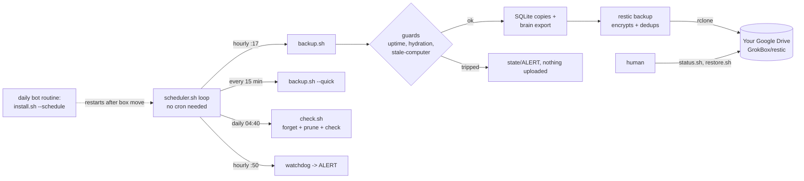

# Grok Box

[](LICENSE) [](https://github.com/dorukardahan/grokbox)

Time-Machine-style, **encrypted** backups of a Grok Bot's persistent Linux box (`/workspace`, `/home/box`) to
**your own Google Drive**, with [restic](https://restic.net) + [rclone](https://rclone.org). No root, no cron daemon,
no server run by anyone else.

```bash
git clone https://github.com/dorukardahan/grokbox /workspace/grokbox
```
**Using a Grok Bot?** Paste the repo link to it: [AGENTS.md](AGENTS.md) tells it exactly what to do and which three
steps need you (Google Cloud OAuth client, one consent click, saving the restic password).

Inspired by the community restic setup idea.

## How it works

Background processes die when the box is moved, so a **daily bot routine** runs `install.sh --schedule` (idempotent)
and `status.sh --local`; it bothers you only when `Overall` is not `OK`.

## Schedule (times in `TZ`, default UTC; all configurable in `config.env`)
| when | what | tag | retention |
|---|---|---|---|
| every hour at :17 | full snapshot + brain export + SQLite copies + forget | `auto` | hourly 24, daily 30, weekly 12, monthly 12 |
| every 15 min | quick snapshot, same roots/excludes (unchanged files are only stat'ed) | `quick` | everything of the last 24 h |
| once, after the first hourly | `test-restore.sh` (real restore of a sample + checksum verify, then deleted) | | |
| daily 04:40 | `check.sh`: forget both tags, prune, `restic check --read-data-subset 5%`; on day 1 of a month also a test restore | | |
| hourly :50 | watchdog: ALERT if no successful hourly snapshot for 3 h | | |

The two tags are forgotten separately, so quick snapshots never disturb the long-term chain. One lock
(`state/backup.lock`) serialises jobs: a quick never starts while another job runs; the hourly waits up to 20 min.
Slots are *due*-based: if the box was busy or off, the job catches up. `touch state/PAUSE` pauses the scheduler.

## Protections
- **Stale-computer guard** (a heuristic, not a guarantee): aborts (exit 4, `state/ALERT`, nothing uploaded) if the file count or bytes
  dropped by more than 20 % vs the last good hourly snapshot, or the newest file mtime is 6 h older. It catches a box that came back
  empty or old; a smaller or subtler rollback can pass. `backup.sh --force "reason"` overrides once (only after a human compared with
  `restore.sh ls latest`). A trip also sets the latch `state/GUARD_TRIPPED`: while it exists no forget/prune runs (backup, `check.sh`);
  only a successful hourly backup (including `--force`) clears it. `status.sh` shows it.
- **Incomplete snapshots** (restic exit 3, unreadable files): the snapshot is kept, an alert is raised and `state/last-partial` is written,
  but it is not treated as a good baseline (no `last-success`, no guard baseline update, no forget). `backup.sh` exits 6.
- **SQLite staging failures** (failed/timed-out copy): alert; databases without a fresh copy are backed up live instead of being excluded, and forget is skipped for that run.
- **Uptime + hydration guards**: no backup in the first 15 minutes after boot, or while the platform's hydration log says files are still being copied in.
- **Consistent SQLite copies** of live databases (SQLite online-backup API) into `staging/sqlite/`, since copying live `.db` files is unsafe.
- **Brain export**: indexes agent data directories and mirrors mounted agent stores (outside the roots) into `staging/brain/` with an `INDEX.md`.
- **Alerts**: failures append to `state/ALERT` + `logs/alerts.log`; `status.sh` prints them first; `status.sh --ack` clears. No e-mail is sent.

## What is and is not backed up
**Backed up**: everything under `BACKUP_ROOTS` (default `/workspace` and `/home/box`) including venvs, `~/.local`, `node_modules`, browser profiles,
and (with `BACKUP_SECRETS=1`, default) credential files, since the repository is encrypted. `staging/` (SQLite copies, brain export) is always included.

**Never uploaded / excluded**: any file named `restic-pass` and the configured password file (always; the brain export skips them too), the one-time `state/auth-url.txt`, `bin/`, `cache/`, restore directories (`restore-*`), `__pycache__`/`*.pyc`/tool caches,
browser HTTP/GPU/shader caches, live `*.db`/`-wal`/`-shm` files that are staged as consistent copies. Switches in `config.env`:
`BACKUP_SECRETS=0`, `BACKUP_PROFILE=lean`, `EXCLUDE_VENVS`, `EXCLUDE_CACHEDIRS`, `EXTRA_EXCLUDES`.

If this repo lives outside every backup root, `staging/`, `config.env` and `state/rebuild-kit` are added to the snapshot paths explicitly
(so the config and tool inventory are still backed up).

## Restore
```bash
cd /workspace/grokbox
./restore.sh list                          # snapshots
./restore.sh ls latest /workspace/project  # browse a snapshot
./restore.sh latest /workspace/project     # restore into /workspace/restore-<date>-latest/ (live files untouched)
./restore.sh <id> --missing-only /workspace/project   # copy back ONLY files that are missing live (asks first; never overwrites)
```
**Disaster on a fresh box**: see [REBUILD.md](REBUILD.md): clone, restore the password (`RESTIC_BACKUP_PASSWORD`) and the OAuth client JSON,
`./auth-gdrive.sh`, `./restore.sh latest`, move folders back.

## Limits: what a box backup cannot contain
Data that lives only on the platform's servers or in the app cannot be read from inside the box, so it is **not** backed up:
- the authoritative server-side copies of memory, routines/automations and conversation history (the box holds a synced local copy, which is what gets backed up);
- connector/plugin OAuth grants (mail, drive, chat apps...);
- app-managed secrets and environment variables (re-add them in the app; keep `RESTIC_BACKUP_PASSWORD` in a password manager too);
- billing and usage settings, pages/canvases;
- agent stores that are not mounted on this box.

You must also keep **outside the box**: the restic password, the Google OAuth client JSON, and access to your Google account.

## Setup in short (a bot does this for you, see AGENTS.md)
1. `cp config.env.example config.env`; `./install.sh` (pinned restic + rclone, SHA256-verified, no root).
2. Restic password: box secret `RESTIC_BACKUP_PASSWORD` (or `./install.sh --gen-password`) and your password manager.
3. Google OAuth client: [docs/google-cloud-setup.md](docs/google-cloud-setup.md) -> `secrets/gdrive-oauth-client.json`; `./auth-gdrive.sh` (one consent click).
   Fallback: `./auth-gdrive.sh --rclone-default-client` (shared, rate-limited client; see [docs/migrate-client.md](docs/migrate-client.md)).
4. `./install.sh --init`, `./backup.sh --dry-run`, `./backup.sh`, `./install.sh --schedule`, `./status.sh`.
5. A daily routine that runs `./install.sh --schedule && ./status.sh --local` and reports only if `Overall` is not `OK`.

## Test
`tests/smoke.sh` runs the whole flow in a temp dir against a local restic repo (no Google Drive needed): install, init, backups, restore with checksum verification,
stale-guard trip (exit 4) + latch, `--force`, incomplete snapshot (exit 6), status no-success flag, test restore, check, status, scheduler start/stop.

## Files
| file | what |
|---|---|
| `config.env.example` | all settings; copy to `config.env` (gitignored). `GB_CONFIG=/path` overrides the config file |
| `AGENTS.md` | step-by-step instructions for a Grok Bot |
| `install.sh` | idempotent setup; `--init`, `--schedule`, `--restart-scheduler`, `--stop-scheduler`, `--gen-password`, `--show-password` |
| `auth-gdrive.sh` | Google Drive login for rclone (own OAuth client, or `--rclone-default-client`) |
| `backup.sh` | hourly (`auto`) or `--quick`; guards, SQLite copies, brain export, forget; `--dry-run`, `--force "why"` |
| `check.sh` | daily forget + prune + check; monthly test restore |
| `test-restore.sh` | real restore of a sample + checksum verification, then deleted |
| `restore.sh` | `list`, `ls`, restore into a restore dir, `--missing-only` |
| `status.sh` | alerts, last runs, scheduler, snapshots; `--local`, `--ack` |
| `scheduler.sh` | cron replacement loop; re-execs itself on code/config change |
| `lib.sh` | shared helpers (config loading, alerts, exclude building, guards) |
| `manifest.py` | file count / bytes / newest mtime for the guard |
| `sqlite-snapshot.py` | consistent copies of live SQLite databases |
| `brain-export.py` | agent data/store discovery, mirror of stores outside the roots, `INDEX.md` |
| `rebuild-kit/inventory.sh` | records installed tools and venv freezes into `state/rebuild-kit/` |
| `excludes.txt`, `excludes-secrets.txt`, `excludes-lean.txt` | always / only if `BACKUP_SECRETS=0` / only if `BACKUP_PROFILE=lean` |
| `docs/google-cloud-setup.md` | exact Google Cloud steps for the OAuth client |
| `docs/migrate-client.md` | move to another OAuth client (new folder + `restic copy`) |
| `REBUILD.md` | runbook: box move, missing files, brand-new box |
| `PRIVACY.md` | privacy policy (also used as the OAuth consent-screen policy URL) |
| `tests/smoke.sh` | local end-to-end test |
| `secrets/` (chmod 700), `state/`, `logs/`, `staging/`, `cache/`, `bin/` | runtime data, gitignored |

## License
MIT, see [LICENSE](LICENSE). Privacy: [PRIVACY.md](PRIVACY.md).
